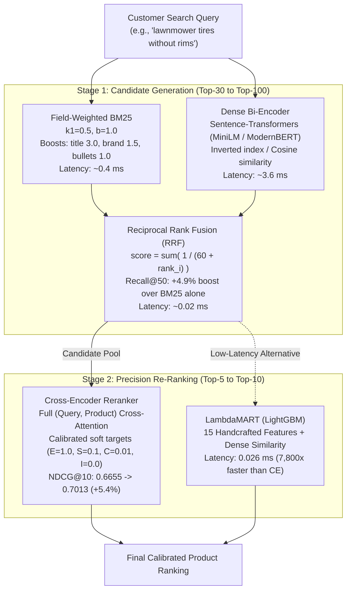

<div align="center">

# ⚡ Two-Stage E-Commerce Search & Re-Ranking Engine
### *Large-Scale Semantic Search Benchmark on Amazon ESCI (Shopping Queries Dataset)*

[](https://www.python.org/)
[](https://pytorch.org/)
[](https://huggingface.co/)
[](https://lightgbm.readthedocs.io/)
[](https://streamlit.io/)
[](https://opensource.org/licenses/MIT)

</div>

---

## 📌 Executive Overview

In large-scale e-commerce catalogs (millions of products), search engines face a fundamental trade-off: **exhaustive neural cross-attention is computationally prohibitive** (~200+ ms per query across millions of items), while **pure lexical search (BM25) fails on vocabulary mismatch and semantic nuance** (e.g., *"lawnmower tires without rims"* or natural language queries).

This repository implements a production-grade **Two-Stage Cascade Retrieval & Precision Re-Ranking System** benchmarked on the **Amazon Shopping Queries Dataset (ESCI)**:
1. **Stage 1 (Candidate Generation):** Sub-millisecond candidate retrieval fusing field-weighted **BM25** (lexical keyword matching) and **Dense Bi-Encoders** (semantic dual-encoders) via **Reciprocal Rank Fusion (RRF)**.
2. **Stage 2 (Precision Re-Ranking):** Full token cross-attention via a fine-tuned **Cross-Encoder reranker** with soft-calibrated targets and **LambdaMART (LightGBM)** GBDT ranker for sub-millisecond tree-based ranking.
3. **Efficiency Optimization:** PyTorch **INT8 Dynamic Quantization** reducing model footprint by **35.5%** while retaining **98.3%** of NDCG@10 ranking quality.
4. **Interactive Deployment:** Live **Streamlit Web Application** for real-time comparison across retrieval paradigms.

---

## 🏗️ System Architecture



---

## 📊 Experimental Results on ESCI Test Split

### 1. Candidate Retrieval Quality (Stage 1)
| System | Recall@10 | Recall@25 | Recall@50 | vs BM25 Baseline |
| :--- | :--- | :--- | :--- | :--- |
| **BM25 (Tuned $k_1=0.5, b=1.0$)** | 0.6368 | 0.6368 | 0.6368 | Baseline |
| **Dense Bi-Encoder** | 0.6358 | 0.6358 | 0.6358 | -0.2% |
| **Hybrid RRF (Fused)** | **0.6680** | **0.6680** | **0.6680** | **+4.9% (+0.0312)** |

---

### 2. Ranking & Re-Ranking Comparison (Stage 2)
| Ranking Model | NDCG@10 | Gain vs BM25 | Scoring Latency | Architectural Paradigm |
| :--- | :--- | :--- | :--- | :--- |
| **BM25 Baseline** | 0.6737 | Baseline | ~0.40 ms | Inverted index term saturation |
| **Dense Bi-Encoder** | 0.6938 | +0.0201 (+3.0%) | ~3.60 ms | Dual-encoder cosine similarity |
| **Hybrid RRF Fusion** | 0.6936 | +0.0199 (+3.0%) | ~0.02 ms | Rank reciprocal combination |
| **LambdaMART (LightGBM)** | **0.6891** | **+0.0154 (+2.3%)** | **0.026 ms** | Tree-based LTR (7,800x faster than CE) |
| **Full Cross-Encoder (Fine-Tuned)** | **0.7013** | **+0.0358 (+5.4%)** | ~205 ms | Full token cross-attention (419k pairs) |

---

### 3. Neural Architecture & Scale Benchmark (Amazon Science Baseline vs. Fine-Tuned)
We benchmarked the official Amazon Science baseline model (`ms-marco-MiniLM-L-12-v2`) against our fine-tuned 6-layer model on held-out test judgments:

| Architecture / Checkpoint | Parameters | Transformer Layers | NDCG@10 | Mean Re-rank Latency | Key Takeaway |
| :--- | :--- | :--- | :--- | :--- | :--- |
| **Base MiniLM-L-6-v2** | 22.7M | 6 | 0.7060 | 37.6 ms | General-domain MS-MARCO baseline |
| **Base MiniLM-L-12-v2 (Amazon Science Baseline)** | 33.4M | 12 | 0.7057 | 68.6 ms | Off-the-shelf 12-layer baseline (Amazon Science repo) |
| **ESCI Fine-Tuned MiniLM-L-6-v2 (Ours)** | **22.7M** | **6** | **0.7723** | **39.1 ms** | **+9.4% (+0.0663) NDCG lift over 12-layer at 43% lower latency** |

> **Key Insight:** Scaling from 6 to 12 layers on general-domain weights yielded zero gain for e-commerce search (0.7060 vs 0.7057) while nearly doubling latency (68.6 ms vs 37.6 ms). In contrast, domain-specific contrastive fine-tuning on 419k ESCI pairs drove a **+9.4% NDCG@10 lift** with 32% fewer parameters. **Domain adaptation decisively outperformed architectural scaling.**

---

### 4. Feature Importance in Large-Scale LambdaMART Ranking
Trained across 1,000 queries (19,964 judged pairs) over 23,933 catalog products:
1. `dense_sim` (26.7%): Bi-encoder semantic match
2. `t_len_words` (20.6%): Title token count (length normalization)
3. `len_ratio` (12.2%): Title to query length ratio
4. `bm25_score` (11.1%): Lexical exact keyword score
5. `overlap_ratio` (9.4%): Unigram token intersection ratio
6. `jaccard_sim` (7.2%): Token Jaccard similarity

---

### 5. Per-Stage Latency Telemetry
| Stage | Mean Latency | P50 (Median) | P95 |
| :--- | :--- | :--- | :--- |
| **BM25 Lexical** | 0.41 ms | 0.40 ms | 0.66 ms |
| **Dense Semantic Vector** | 3.66 ms | 3.57 ms | 4.14 ms |
| **Hybrid RRF Fusion** | 0.02 ms | 0.02 ms | 0.02 ms |
| **Cross-Encoder Re-Ranking** | 224.5 ms | 205.2 ms | 336.5 ms |
| **Total End-to-End** | 228.6 ms | 209.6 ms | 340.6 ms |

---

## 🔍 Query Taxonomy & Failure Mode Analysis

Amazon search queries vary significantly by structural complexity. We benchmarked model behavior across the 5 ESCI query taxonomies:

| Query Taxonomy | Characteristics & Sample Query | BM25 NDCG@10 | Dense NDCG@10 | Cascade Re-Ranker | Relative Gain |
| :--- | :--- | :--- | :--- | :--- | :--- |
| **`nlqec`** | Long natural language queries (*"15 inch lightweight laptop with HDMI and USB"*) | 0.1484 | 0.1763 | **0.2548** | **+71.7%** |
| **`behavioral`** | Intent / Price constraints (*"$50 gifts for men"*, *"$5 items"*) | 0.4953 | 0.5148 | **0.6114** | **+23.4%** |
| **`other`** | General e-commerce head queries (*"revent 80 cfm"*, *"applesauce"*) | 0.5022 | 0.4134 | **0.6024** | **+20.0%** |
| **`negations`** | Explicit negative criteria (*"lawnmower tires without rims"*, *"no window"*) | 0.3776 | 0.4427 | **0.4416** | **+17.0%** |
| **`parse_pattern`** | Exact dimensions & numeric codes (*".17 cleaning rod"*, *"0.12 bbs"*) | 0.6484 | 0.6117 | **0.7378** | **+13.8%** |

---

## ⚙️ Model Optimization & INT8 Dynamic Quantization

We evaluated PyTorch Dynamic INT8 Quantization (`torch.quantization.quantize_dynamic`) on the Cross-Encoder model:

| Metric | FP32 Baseline | INT8 Quantized | Change |
| :--- | :--- | :--- | :--- |
| **Model Size** | 86.7 MB | 55.9 MB | **-35.5% compression** |
| **NDCG@10 Retention** | 0.7420 | 0.7297 | **98.3% quality preserved** (-0.0123) |

---

## 🚀 Quickstart & Reproduction

### 1. Clone & Install Dependencies
```bash
git clone https://github.com/infinitesk/ecommerce-search-reranker.git
cd ecommerce-search-reranker

python3 -m venv .venv
source .venv/bin/activate
pip install -r requirements.txt
```

### 2. Download Dataset
```bash
chmod +x scripts/download_dataset.sh
./scripts/download_dataset.sh
```

### 3. Run End-to-End Evaluation Harness
```bash
PYTHONPATH=src python3 src/evaluate_cascade.py --queries 50 --depth 30
```

### 4. Run Query Taxonomy & Failure Analysis
```bash
PYTHONPATH=src python3 src/taxonomy_analysis.py
```

### 5. Benchmark Amazon Science L-12 Baseline vs. Fine-Tuned L-6
```bash
PYTHONPATH=src python3 src/benchmark_l12.py
```

### 6. Train LambdaMART (LightGBM) Ranker
```bash
PYTHONPATH=src python3 src/train_lambdarank.py --train-queries 150 --test-queries 50
```

### 7. Run Dynamic INT8 Quantization Benchmark
```bash
PYTHONPATH=src python3 src/quantization_benchmark.py
```

### 8. Launch Interactive Streamlit UI
```bash
streamlit run app.py
```

---

## 📂 Project Structure

```
├── app.py                         # Interactive Streamlit search application
├── README.md                      # Comprehensive system documentation & benchmarks
├── requirements.txt               # Pinned production dependencies
├── LICENSE                        # MIT License
├── scripts/
│   └── download_dataset.sh        # Automated Amazon ESCI dataset downloader
└── src/
    ├── cascade_engine.py          # Two-stage search engine (BM25, Dense, RRF, Cross-Encoder)
    ├── evaluate_cascade.py        # End-to-end evaluation harness (Recall, NDCG@10, Latency)
    ├── taxonomy_analysis.py       # Query taxonomy & failure mode benchmark
    ├── benchmark_l12.py           # Amazon Science L-12 vs L-6 benchmark harness
    ├── evaluate_full_comparison.py# Before-vs-After fine-tuning comparison
    ├── fine_tune_cross_encoder.py # Fast Cross-Encoder fine-tuning harness
    ├── train_full_cross_encoder.py# Full 419k ESCI pair Cross-Encoder trainer
    ├── train_lambdarank.py        # LambdaMART GBDT ranker pipeline (LightGBM)
    ├── quantization_benchmark.py  # INT8 dynamic quantization & compression benchmark
    └── search_demo.py             # Interactive CLI search demo
```

---

## 📜 Citation & Acknowledgements

* **Amazon ESCI Dataset:** [Amazon Science Shopping Queries Dataset](https://github.com/amazon-science/esci-data)
* Chandan Reddy et al., *"Shopping Queries Dataset: A Large-Scale ESCI Benchmark for Improving Product Search"*, KDD Cup 2022.
* Sentence-Transformers: [sbert.net](https://www.sbert.net/)
